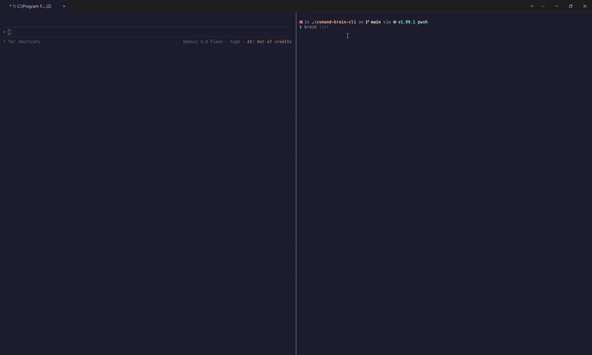

# agy-brain

[](https://github.com/caiosaboia/agy-brain/actions/workflows/ci.yml)
[](https://www.rust-lang.org/)
[](https://opensource.org/licenses/MIT)
[](https://github.com/caiosaboia/agy-brain)
[](https://github.com/caiosaboia/agy-brain)

**agy-brain** is a blazing-fast, standalone CLI navigator and session inspector for **Antigravity CLI** and **Claude Code**, written 100% in Pure Rust. It allows developers to instantly jump to workspace brain/project directories, inspect generated artifacts and plan files, explore sessions via an embedded terminal user interface (TUI), and manage session pins across Windows, macOS, and Linux.

---

## Highlights

* **100% Pure Rust & Single Binary:** Zero external runtime dependencies. No Python, Node, or system SQLite library needed (bundled C SQLite included).
* **Dual Session Backends:** Works against **Antigravity CLI**'s SQLite database and brain folders, or **Claude Code**'s on-disk JSONL transcripts under `~/.claude/projects` - the same commands behave consistently on either, auto-detected or selected explicitly with `--provider`.
* **Embedded Interactive TUI:** Built-in dashboard powered by `ratatui` and `crossterm` with instant fuzzy search, side-by-side session inspection, live metrics, and keyboard shortcuts.
* **Smart Auto-Discovery:** Seamlessly discovers Antigravity database files and brain directories, or Claude Code's project history, across platform-specific locations or custom `$AGY_APP_DIR` paths.
* **Workspace Pinning:** Pin primary sessions per workspace using local marker files or the global pin registry, kept separate per provider so both can coexist without collisions.
* **Universal Shell Integration:** Native `cd` navigation support across **PowerShell**, **Bash**, **Zsh**, and **Fish**.
* **Native Desktop Integration:** Open sessions in your platform's default file manager (`explorer.exe`, `open`, `xdg-open`) or preferred editor (`$EDITOR`, `code`, `nvim`, `nano`).
* **AI Agent Harness Optimization:** Minimalist subcommands (`brain plan`) and global flags (`--paths`, `--json`) designed for autonomous agents (Google Antigravity CLI and Claude Code CLI) to discover plans in 1 step with zero ANSI/ASCII token overhead.

---

## Demo

<p align="center">
  
  <br>
  <em>Navegação rápida de workspaces, inspeção de sessões e TUI interativa (<a href="docs/assets/demo.mp4">assistir em vídeo MP4 original</a>).</em>
</p>

---

## Session Backends

agy-brain supports two providers behind the same command surface:

* **`antigravity`** (default when its database is found): Antigravity CLI's `conversation_summaries.db` + `brain/<uuid>/` artifact tree.
* **`claude-code`**: Claude Code's `~/.claude/projects/<project>/<session-uuid>.jsonl` transcripts. Pins and renamed titles are kept in agy-brain-owned sidecar files next to Claude Code's own data; agy-brain never writes into Claude Code's own files. `go`/`open`/`edit`/`nvim` jump to the session's real recorded project directory, and `artifacts` reports the transcript plus any matching `~/.claude/todos/` entries.

Select the provider explicitly with `--provider antigravity|claude-code` (or the `AGY_PROVIDER` env var); by default agy-brain auto-detects based on what it finds. Run `agy-brain doctor` to see which provider was selected and why. See [`docs/specs/claude-code-provider.md`](docs/specs/claude-code-provider.md) for the full design.

---

## Quick Installation

### Windows (PowerShell)
Run in PowerShell:
```powershell
irm https://raw.githubusercontent.com/caiosaboia/agy-brain/main/install.ps1 | iex
```

### Linux & macOS (Bash / Zsh)
Run in your terminal:
```bash
curl -fsSL https://raw.githubusercontent.com/caiosaboia/agy-brain/main/install.sh | bash
```

### Via Cargo
If you have the Rust toolchain installed:
```bash
cargo install --git https://github.com/caiosaboia/agy-brain.git
```

### Manual Download
Download the pre-compiled binary for your architecture from [GitHub Releases](https://github.com/caiosaboia/agy-brain/releases):
* **Windows (x86_64):** `agy-brain-x86_64-pc-windows-msvc.zip`
* **Linux (x86_64):** `agy-brain-x86_64-unknown-linux-gnu.tar.gz`
* **macOS (Apple Silicon / aarch64):** `agy-brain-aarch64-apple-darwin.tar.gz`
* **macOS (Intel / x86_64):** `agy-brain-x86_64-apple-darwin.tar.gz`

Extract the binary and place it in your `$PATH`.

---

## Shell Setup (Directory Navigation)

To enable automatic directory jumping (`cd`) directly to session brain folders, configure the shell integration hook.

### Automatic Configuration
```bash
agy-brain install
```
*Detects your active shell (PowerShell, Bash, Zsh, or Fish) and appends the hook idempotently to your profile.*

### Manual Configuration

* **PowerShell (`$PROFILE`):**
  ```powershell
  Invoke-Expression (& agy-brain init powershell | Out-String)
  ```

* **Bash (`~/.bashrc`):**
  ```bash
  eval "$(agy-brain init bash)"
  ```

* **Zsh (`~/.zshrc`):**
  ```bash
  eval "$(agy-brain init zsh)"
  ```

* **Fish (`~/.config/fish/config.fish`):**
  ```fish
  agy-brain init fish | source
  ```

After reloading your shell, you can use either `brain` or `cd-brain`.

---

## Usage

### 1. Interactive TUI Mode
Run without arguments to launch the embedded TUI dashboard:
```bash
brain
# or
agy-brain tui
```

**Keyboard Shortcuts in TUI:**
* `Up` / `Down` or `j` / `k`: Navigate session list.
* `Type any query`: Instant fuzzy filter across UUID, title, status, and path.
* `Enter`: Jump (`cd`) into the selected brain directory.
* `Ctrl + O`: Open the brain directory in OS file manager.
* `Ctrl + V` / `Ctrl + N`: Open session directly in Neovim (suspends TUI, returns upon exit).
* `Ctrl + P`: Pin or unpin the selected session for the current workspace.
* `Ctrl + D`: Delete selected session (prompts modal confirmation).
* `Ctrl + E`: Open the brain folder in your default code editor.
* `Ctrl + A`: Toggle between sessions of the current workspace and all global sessions.
* `Esc`: Exit dashboard.

---

### 2. Direct Subcommands

* **Navigate directly (`cd`):**
  ```bash
  # Jump to primary/pinned session for the current workspace:
  brain go

  # Jump to session by index (from 'list') or UUID:
  brain go 0
  brain go f6e483f5-5c92-49a2-a3cb-7597a280aa13
  ```

* **List sessions:**
  ```bash
  # List sessions belonging to current project:
  agy-brain list

  # List all sessions across the machine:
  agy-brain list --all
  ```

* **Inspect session details:**
  ```bash
  agy-brain info
  agy-brain info 0
  agy-brain info <UUID>
  ```

* **Inspect generated artifacts:**
  ```bash
  # View plans, markdown files, logs, and scratch scripts:
  agy-brain artifacts
  ```

* **Pin / Unpin workspace session:**
  ```bash
  # Pin current or specified session to the workspace:
  agy-brain pin
  agy-brain pin f6e483f5-5c92-49a2-a3cb-7597a280aa13

  # Remove workspace pin:
  agy-brain unpin
  ```

* **Delete session:**
  ```bash
  # Delete primary session for current workspace (interactive confirmation):
  agy-brain delete

  # Delete by index or UUID:
  agy-brain delete 3
  agy-brain delete 706a4ef8-9dc7-49b4-93bc-3d4a716f2b84

  # Force delete without confirmation prompt:
  agy-brain delete 3 --force
  ```

* **Open in Neovim:**
  ```bash
  # Open current workspace session in Neovim:
  brain nvim

  # Open by index or UUID:
  brain nvim 0
  brain nvim 706a4ef8-9dc7-49b4-93bc-3d4a716f2b84

  # Using shorthand alias:
  brain v
  ```

* **Open in File Manager:**
  ```bash
  agy-brain open
  ```

* **Open in Code Editor:**
  ```bash
  agy-brain edit
  ```

* **Run Health Diagnostics:**
  ```bash
  agy-brain doctor
  ```

---

## Command Reference

| Command | Alias | Description |
|---|---|---|
| `brain` / `cd-brain` | | Interactive Ratatui TUI dashboard with live preview |
| `agy-brain go [target]` | | Navigate directly into the resolved brain directory |
| `agy-brain list [-a]` | `ls` | Display sessions table with status, steps, and dates |
| `agy-brain info [target]` | `show` | Render session card with detailed statistics |
| `agy-brain artifacts [target] [-p]` | `art` | List `.md` plans, screenshots, and scratch files (`--plan` filters plans) |
| `agy-brain plan [target] [-a] [-c]` | `p` | Token-optimized plan discovery (`-a` all, `-c` cat content to stdout) |
| `agy-brain open [target]` | | Open session directory in Explorer / Finder / xdg-open |
| `agy-brain nvim [target]` | `vim`, `v` | Open session directory directly in Neovim |
| `agy-brain edit [target]` | | Open session directory in code editor |
| `agy-brain pin [id]` | | Pin session as primary for the current workspace |
| `agy-brain unpin` | | Remove pin from current workspace |
| `agy-brain delete [id]` | `rm`, `remove` | Delete session from SQLite, FTS index, and disk |
| `agy-brain doctor` | | Validate Antigravity DB paths and environment health |
| `agy-brain init <shell>` | | Output shell integration function script |
| `agy-brain install [shell]`| | Automatically append hook to user's shell profile |

**Global Harness Flags:**
* `--paths`: Output raw newline-delimited paths without tables, headers, or ANSI colors (ideal for CLI tools and LLM context).
* `--json`: Output compact, structured JSON for scripts, pipelines, and harnesses.
* `--subagents` (`-s`): Include background subagent sessions in listings and TUI.

---

## Benchmarks & AI Harness Performance

agy-brain is engineered not only for human developers but also as an ultra-fast, token-efficient session and planning inspector for autonomous AI harnesses (**Google Antigravity CLI** and **Claude Code CLI**).

### Benchmark Methodology

To measure discovery performance without relying on synthetic mocks, we execute a real **End-to-End (E2E) sandbox benchmark** (`benchmarks/harness_planning_benchmark.py`):
1. **Isolated Micro-Sandbox (`teste-*`):** Temporary workspace directories (`teste-ws-alvo` and a distractor `teste-ws-ruido`) are generated dynamically in `%TEMP%`.
2. **Zero-Byte Planning Artifacts:** Three real sessions per provider seed empty (`0` byte) files (`teste-plan-1.md`, `teste-plan-2.md`, `teste-plan-ruido.md`) to minimize prompt token noise.
3. **Dual-Harness Execution:** Real agent sessions run against Google Antigravity CLI (`gemini-3.8-flash-low`, `--effort low`) and Claude Code CLI (`combo-1`, `--effort low` via local OmniRoute proxy on port `20128`).
4. **Deterministic Teardown:** A fail-safe `finally` handler invokes `brain delete <uuid> --force` for 100% of generated test sessions, removes sandboxes, and verifies zero test residues remain.

### Real E2E Sandbox Results (Ground Truth: 2/2 Target Plans)

| Provider & Harness | Discovery Mode | Wall-Clock Latency | Turns | Total Tokens (In / Out) | Found / Target | Precision | Recall | F1 Score |
|---|---|---:|---:|---:|:---:|---:|---:|---:|
| **Antigravity CLI** (`agy.exe`) | **With `brain`** (`plan --paths`) | 56,021.5 ms | 1 | 36,735 (36,302 / 433) | 2 / 2 | 1.00 | 1.00 | **1.00** |
| **Antigravity CLI** (`agy.exe`) | Without `brain` (filesystem scan) | 29,667.3 ms | 1 | 29,936 (29,679 / 257) | 2 / 2 | 1.00 | 1.00 | **1.00** |
| **Claude Code CLI** (`claude`) | **With `brain`** (`plan --paths`) | 29,356.5 ms | 10 | 122,335 (121,443 / 892) | 2 / 2 | 1.00 | 1.00 | **1.00** |
| **Claude Code CLI** (`claude`) | Without `brain` (filesystem scan) | 7,354.2 ms | 2 | 26,290 (25,980 / 310) | 2 / 2 | 1.00 | 1.00 | **1.00** |

*Note: In an empty 2-file micro-sandbox, filesystem `ls` is fast. However, as demonstrated in the asymptotic scaling table below, unassisted filesystem discovery rapidly degrades and collapses at scale.*

### Token & Latency Optimization (Before vs After in `feat/harness-token-optimization`)

By adding dedicated opt-in minimal flags (`--paths` for one clean path per line, `--json` for minified JSON, and `brain plan --all`), decorative ASCII table borders and ANSI escape sequences are completely eliminated:

| Metric | Antigravity CLI (Before: `list` + `artifacts`) | Antigravity CLI (After: `plan --paths`) | Claude Code (Before: `list` + `artifacts`) | Claude Code (After: `plan --paths`) |
|---|---:|---:|---:|---:|
| **Command Pattern** | `brain list` -> `brain artifacts` | `brain plan --all --paths` | `brain list` -> `brain artifacts` | `brain plan --all --paths` |
| **Execution Latency** | 69,426.4 ms | **56,021.5 ms** (-19.3%) | 86,307.1 ms | **29,356.5 ms** (**-66.0%**) |
| **Tokens Consumed** | 50,126 | **36,735** (**-26.7%**) | 94,727 | 122,335 |
| **F1 Accuracy** | 1.00 | **1.00** | 1.00 | **1.00** |
| **ASCII / ANSI Formatting** | Decorated tables | **Clean path list (0 ANSI)** | Decorated tables | **Clean path list (0 ANSI)** |

### Asymptotic Scaling Simulation (N = 50, 250, 1000 Sessions)

When navigating projects with large session histories, unanchored filesystem searches suffer from severe context explosion and noise leakage:

| Harness Provider | Search Strategy | N = 50 (ms / tok / F1) | N = 250 (ms / tok / F1) | N = 1000 (ms / tok / F1) |
|---|---|---|---|---|
| **Antigravity CLI** | Without `brain` (global glob `*plan*.md`) | 69.8 ms / 2,226 tok / F1 0.20 | 83.1 ms / 10,957 tok / F1 0.04 | 82.8 ms / **43,923 tok** / **F1 0.01** |
| **Antigravity CLI** | Without `brain` (`rg` transcript -> `*plan*.md`) | 156.8 ms / 766 tok / F1 0.78 | 164.9 ms / 2,027 tok / F1 0.39 | 239.4 ms / 6,959 tok / **F1 0.13** |
| **Antigravity CLI** | **With `brain` (`artifacts --plan --paths`)** | **26.9 ms / 271 tok / F1 1.00** | **39.8 ms / 272 tok / F1 1.00** | **79.4 ms / 272 tok / F1 1.00** |
| **Claude Code CLI** | Without `brain` (global glob `plans/*.md`) | 68.7 ms / 495 tok / F1 0.26 | 68.4 ms / 2,175 tok / F1 0.07 | 69.6 ms / 8,509 tok / **F1 0.02** |
| **Claude Code CLI** | Without `brain` (`encoded-dir` collision) | 70.0 ms / 32 tok / **F1 0.75** | 70.2 ms / 32 tok / **F1 0.75** | 69.1 ms / 32 tok / **F1 0.75** |
| **Claude Code CLI** | **With `brain` (`plan --paths`)** | **85.7 ms / 232 tok / F1 1.00** | **91.1 ms / 232 tok / F1 1.00** | **87.3 ms / 233 tok / F1 1.00** |

### Reproducing the Benchmark

```powershell
# Run the automated E2E sandbox benchmark:
python benchmarks/harness_planning_benchmark.py --json-out benchmark_results.json

# Run unit and integration tests (54 Rust tests, 31 Python tests):
cargo test --quiet
python -m unittest discover -s tests -p "test_*.py"
```

---

## Building from Source

```bash
# Clone the repository
git clone https://github.com/caiosaboia/agy-brain.git
cd agy-brain

# Run tests
cargo test

# Run linter
cargo clippy --all-targets -- -D warnings

# Build optimized release binary
cargo build --release
```

The compiled binary will be located at `target/release/agy-brain` (or `agy-brain.exe` on Windows).

---

## License

MIT License &copy; 2026 Caio Saboia.
