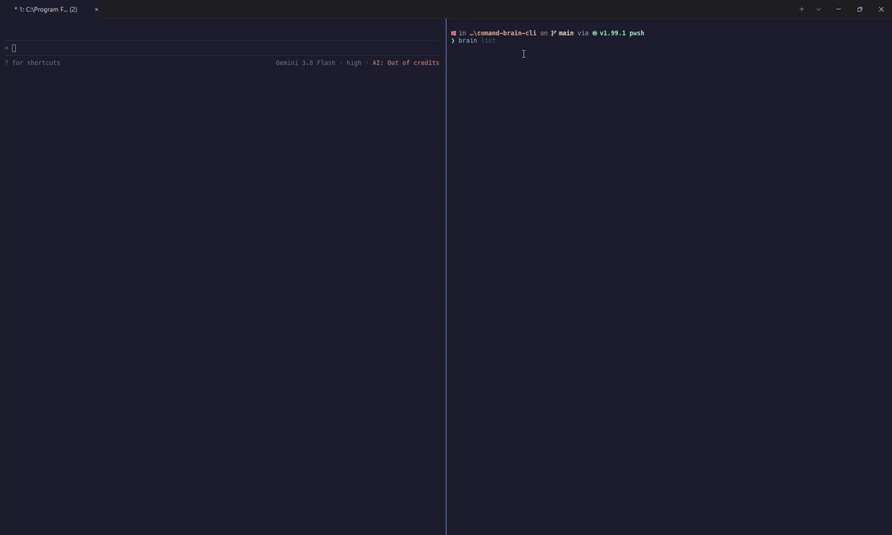

# agy-brain

[](https://github.com/caiosaboia/agy-brain/actions/workflows/ci.yml)
[](https://www.rust-lang.org/)
[](https://opensource.org/licenses/MIT)
[](https://github.com/caiosaboia/agy-brain)
[](https://github.com/caiosaboia/agy-brain)

[English](README.md) | [Português](README.pt-BR.md)

**agy-brain** é um navegador CLI e inspetor de sessões ultrarrápido e independente para **Antigravity CLI** e **Claude Code**, escrito 100% em Pure Rust. Ele permite que desenvolvedores saltem instantaneamente para diretórios de sessões/projetos (pastas de cérebro), inspecionem artefatos gerados e arquivos de plano, explorem sessões através de uma interface de terminal interativa (TUI) embutida e gerenciem fixações (pins) de workspace no Windows, macOS e Linux.

---

## Destaques

* **100% Pure Rust e Binário Único:** Zero dependências de tempo de execução externas. Não requer Python, Node ou biblioteca SQLite do sistema (SQLite C embutido).
* **Dois Provedores de Sessão Suportados:** Opera sobre a base SQLite e pastas de cérebro do **Antigravity CLI**, ou sobre os transcripts JSONL do **Claude Code** em `~/.claude/projects` - os mesmos comandos se comportam de forma consistente em ambos, com detecção automática ou seleção explícita via `--provider`.
* **TUI Interativa Integrada:** Painel no terminal desenvolvido com `ratatui` e `crossterm` com busca fuzzy instantânea, inspeção lado a lado de sessões, métricas em tempo real e atalhos de teclado.
* **Autodescoberta Inteligente:** Descobre automaticamente bancos de dados e diretórios de cérebro do Antigravity, ou o histórico de projetos do Claude Code, considerando caminhos padrão de cada SO ou caminhos personalizados via `$AGY_APP_DIR`.
* **Fixação de Workspaces (Pinning):** Fixe sessões principais por workspace através de arquivos marcadores locais ou pelo registro global de pins, mantidos isolados por provedor para coexistência sem conflitos.
* **Integração Universal com Shells:** Suporte nativo à navegação com `cd` automático no **PowerShell**, **Bash**, **Zsh** e **Fish**.
* **Integração com o Ambiente Desktop:** Abra pastas de sessões no gerenciador de arquivos padrão do SO (`explorer.exe`, `open`, `xdg-open`) ou no seu editor preferido (`$EDITOR`, `code`, `nvim`, `nano`).
* **Otimização para Agentes de IA (Harnesses):** Subcomandos minimalistas (`brain plan`) e flags globais (`--paths`, `--json`) projetados para que agentes autônomos (Google Antigravity CLI e Claude Code CLI) descubram planos em 1 único turno com zero desperdício de tokens em formatações ANSI/ASCII.

---

## Demonstração

<p align="center">
  
  <br>
  <em>Navegação rápida de workspaces, inspeção de sessões e TUI interativa (<a href="docs/assets/demo.mp4">assistir em vídeo MP4 original</a>).</em>
</p>

---

## Provedores de Sessão

O agy-brain suporta dois provedores sob a mesma interface de comandos:

* **`antigravity`** (padrão quando o banco de dados é detectado): Base `conversation_summaries.db` do Antigravity CLI e árvore de artefatos em `brain/<uuid>/`.
* **`claude-code`**: Transcripts em `~/.claude/projects/<projeto>/<uuid-sessao>.jsonl` do Claude Code. Pins e títulos renomeados são salvos em arquivos sidecar proprietários do agy-brain junto aos dados do Claude Code; o agy-brain nunca modifica os arquivos nativos do Claude Code. Os comandos `go`, `open`, `edit` e `nvim` navegam para o diretório de projeto registrado da sessão, e `artifacts` lista o transcript e entradas correspondentes em `~/.claude/todos/`.

Selecione o provedor explicitamente com `--provider antigravity|claude-code` (ou pela variável de ambiente `AGY_PROVIDER`); por padrão, o agy-brain detecta automaticamente com base no ambiente. Execute `agy-brain doctor` para verificar qual provedor foi selecionado e o motivo. Consulte [`docs/specs/claude-code-provider.md`](docs/specs/claude-code-provider.md) para a especificação completa de design.

---

## Instalação Rápida

### Windows (PowerShell)
Execute no PowerShell:
```powershell
irm https://raw.githubusercontent.com/caiosaboia/agy-brain/main/install.ps1 | iex
```

### Linux & macOS (Bash / Zsh)
Execute no terminal:
```bash
curl -fsSL https://raw.githubusercontent.com/caiosaboia/agy-brain/main/install.sh | bash
```

### Via Cargo
Se você possui a toolchain do Rust instalada:
```bash
cargo install --git https://github.com/caiosaboia/agy-brain.git
```

### Download Manual
Baixe o binário pré-compilado para sua arquitetura na página de [GitHub Releases](https://github.com/caiosaboia/agy-brain/releases):
* **Windows (x86_64):** `agy-brain-x86_64-pc-windows-msvc.zip`
* **Linux (x86_64):** `agy-brain-x86_64-unknown-linux-gnu.tar.gz`
* **macOS (Apple Silicon / aarch64):** `agy-brain-aarch64-apple-darwin.tar.gz`
* **macOS (Intel / x86_64):** `agy-brain-x86_64-apple-darwin.tar.gz`

Extraia o executável e adicione-o ao seu `$PATH`.

---

## Configuração do Shell (Navegação de Diretórios)

Para habilitar a troca automática de diretório (`cd`) diretamente para a pasta de cérebro das sessões, configure o hook de integração com o shell.

### Configuração Automática
```bash
agy-brain install
```
*Detecta o shell ativo (PowerShell, Bash, Zsh ou Fish) e adiciona o hook ao arquivo de perfil de forma idempotente.*

### Configuração Manual

* **PowerShell (`$PROFILE`):**
  ```powershell
  Invoke-Expression (& agy-brain init powershell | Out-String)
  ```

* **Bash (`~/.bashrc`):**
  ```bash
  eval "$(agy-brain init bash)"
  ```

* **Zsh (`~/.zshrc`):**
  ```bash
  eval "$(agy-brain init zsh)"
  ```

* **Fish (`~/.config/fish/config.fish`):**
  ```fish
  agy-brain init fish | source
  ```

Após recarregar o shell, você poderá utilizar o comando `brain` ou o alias `cd-brain`.

---

## Como Usar

### 1. Modo TUI Interativo
Execute sem argumentos para abrir o painel TUI interativo:
```bash
brain
# ou
agy-brain tui
```

**Atalhos de Teclado na TUI:**
* `Seta para Cima` / `Seta para Baixo` ou `j` / `k`: Navegar pela lista de sessões.
* `Digitar qualquer texto`: Filtro fuzzy instantâneo por UUID, título, status e caminho.
* `Enter`: Navegar (`cd`) para o diretório de cérebro selecionado.
* `Ctrl + O`: Abrir a pasta de cérebro no gerenciador de arquivos do SO.
* `Ctrl + V` / `Ctrl + N`: Abrir a sessão diretamente no Neovim (suspende a TUI e retorna ao sair).
* `Ctrl + P`: Fixar ou desfixar (pin) a sessão selecionada no workspace atual.
* `Ctrl + D`: Excluir a sessão selecionada (exibe confirmação modal).
* `Ctrl + E`: Abrir a pasta de cérebro no seu editor de código padrão.
* `Ctrl + A`: Alternar entre sessões do workspace atual e todas as sessões globais.
* `Esc`: Sair do painel.

---

### 2. Subcomandos Diretos

* **Navegação direta (`cd`):**
  ```bash
  # Pular para a sessao principal/fixada do workspace atual:
  brain go

  # Pular para a sessao por indice (da lista) ou UUID:
  brain go 0
  brain go f6e483f5-5c92-49a2-a3cb-7597a280aa13
  ```

* **Listar sessões:**
  ```bash
  # Listar sessoes pertencentes ao projeto atual:
  agy-brain list

  # Listar todas as sessoes em todo o sistema:
  agy-brain list --all
  ```

* **Inspecionar detalhes da sessão:**
  ```bash
  agy-brain info
  agy-brain info 0
  agy-brain info <UUID>
  ```

* **Inspecionar artefatos gerados:**
  ```bash
  # Ver planos, arquivos markdown, logs e scripts em scratch:
  agy-brain artifacts
  ```

* **Fixar / Desfixar sessão no workspace:**
  ```bash
  # Fixar sessao atual ou especifica no workspace:
  agy-brain pin
  agy-brain pin f6e483f5-5c92-49a2-a3cb-7597a280aa13

  # Remover a fixacao do workspace:
  agy-brain unpin
  ```

* **Excluir sessão:**
  ```bash
  # Excluir a sessao principal do workspace atual (confirmacao interativa):
  agy-brain delete

  # Excluir por indice ou UUID:
  agy-brain delete 3
  agy-brain delete 706a4ef8-9dc7-49b4-93bc-3d4a716f2b84

  # Forcar exclusao sem prompt de confirmacao:
  agy-brain delete 3 --force
  ```

* **Abrir no Neovim:**
  ```bash
  # Abrir a sessao do workspace atual no Neovim:
  brain nvim

  # Abrir por indice ou UUID:
  brain nvim 0
  brain nvim 706a4ef8-9dc7-49b4-93bc-3d4a716f2b84

  # Utilizando alias curto:
  brain v
  ```

* **Abrir no Gerenciador de Arquivos:**
  ```bash
  agy-brain open
  ```

* **Abrir no Editor de Código:**
  ```bash
  agy-brain edit
  ```

* **Diagnóstico de Saúde do Ambiente:**
  ```bash
  agy-brain doctor
  ```

---

## Referência de Comandos

| Comando | Alias | Descrição |
|---|---|---|
| `brain` / `cd-brain` | | Painel interativo TUI com Ratatui e visualização em tempo real |
| `agy-brain go [alvo]` | | Navega diretamente para o diretório de cérebro resolvido |
| `agy-brain list [-a]` | `ls` | Exibe tabela de sessões com status, passos e datas |
| `agy-brain info [alvo]` | `show` | Renderiza cartão de detalhes da sessão com estatísticas |
| `agy-brain artifacts [alvo] [-p]` | `art` | Lista planos `.md`, capturas de tela e arquivos em scratch (`--plan` filtra apenas planos) |
| `agy-brain plan [alvo] [-a] [-c]` | `p` | Descoberta de planos otimizada em tokens (`-a` todos, `-c` exibe o conteúdo no stdout) |
| `agy-brain open [alvo]` | | Abre o diretório da sessão no Explorer / Finder / xdg-open |
| `agy-brain nvim [alvo]` | `vim`, `v` | Abre o diretório da sessão diretamente no Neovim |
| `agy-brain edit [alvo]` | | Abre o diretório da sessão no editor de código padrão |
| `agy-brain pin [id]` | | Fixa a sessão como principal para o workspace atual |
| `agy-brain unpin` | | Remove a fixação da sessão no workspace atual |
| `agy-brain delete [id]` | `rm`, `remove` | Remove a sessão do SQLite, índice FTS e disco |
| `agy-brain doctor` | | Valida os caminhos da base Antigravity e integridade do ambiente |
| `agy-brain init <shell>` | | Gera o script de integração com a função do shell |
| `agy-brain install [shell]`| | Adiciona o hook automaticamente ao perfil do shell do usuário |

**Flags Globais para Agentes de IA (Harnesses):**
* `--paths`: Exibe caminhos puros separados por quebra de linha, sem tabelas, cabeçalhos ou cores ANSI (ideal para scripts e contexto de LLMs).
* `--json`: Exibe JSON compacto e estruturado para automações, pipelines e harnesses.
* `--subagents` (`-s`): Inclui sessões de subagentes em segundo plano nas listagens e na TUI.

---

## Benchmarks & Desempenho com Agentes de IA

O `agy-brain` foi projetado tanto para desenvolvedores humanos quanto como um inspetor de sessões e planos de execução ultrarrápido e eficiente em tokens para harnesses de agentes autônomos (**Google Antigravity CLI** e **Claude Code CLI**). Com as flags minimalistas (`--paths` e `--json`), ele fornece descoberta de planos determinística e com zero overhead diretamente para a janela de contexto de LLMs.

### Resumo Executivo de Desempenho

| Harness de IA | Descoberta Recomendada | Turnos | Overhead de Contexto | Escala (N = 1.000) | Acurácia (F1) |
|---|---|:---:|:---:|:---:|:---:|
| **Google Antigravity CLI** (`agy.exe`) | `brain plan --paths` | 1 | ~272 tokens (0 ANSI) | 79.4 ms (tokens constantes) | **1.00** |
| **Claude Code CLI** (`claude`) | `brain plan --paths` | 1 | ~233 tokens (0 ANSI) | 87.3 ms (tokens constantes) | **1.00** |

*Em comparação, varreduras recursivas desordenadas no sistema de arquivos (`find` / `glob`) degradam severamente em escala, consumindo até **43.923 tokens** e reduzindo a acurácia de descoberta para **F1 0.01** em 1.000 sessões devido ao ruído de contexto e truncamento de prompt.*

As métricas empíricas são validadas continuamente através de um executor em micro-sandboxes End-to-End (E2E) reais e de uma suíte de simulação assintótica. Para detalhes completos de arquitetura, metodologia de benchmark e comandos de reprodução, consulte a [Documentação dos Benchmarks](benchmarks/README.md).

---

## Compilação a partir do Código-Fonte

```bash
# Clonar o repositorio
git clone https://github.com/caiosaboia/agy-brain.git
cd agy-brain

# Executar testes
cargo test

# Executar linter
cargo clippy --all-targets -- -D warnings

# Compilar binario otimizado para producao
cargo build --release
```

O binário compilado estará localizado em `target/release/agy-brain` (ou `agy-brain.exe` no Windows).

---

## Licença

Licença MIT &copy; 2026 Caio Saboia.
